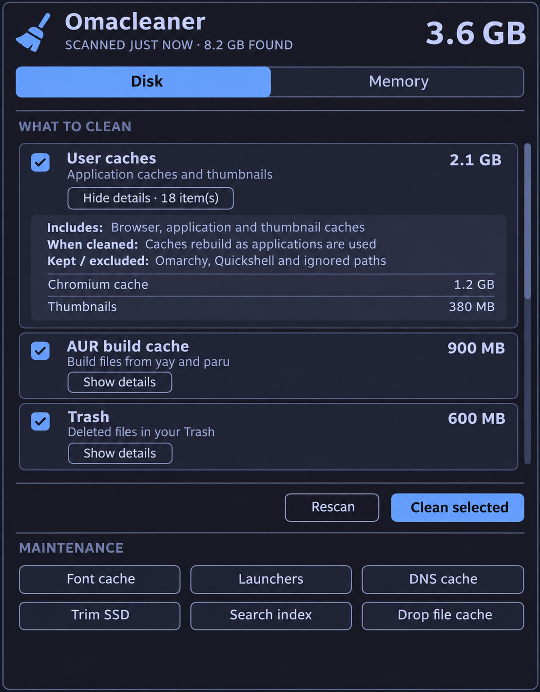

# Omacleaner

An [Omarchy](https://omarchy.org) bar plugin for disk cleanup, application memory usage, and system maintenance. Review caches, logs, Trash, developer files, and other cleanup categories before removing selected items. Use the **Memory** tab to inspect application usage and quit selected applications. The same tools are available through a scriptable CLI with JSON output.

**Author: Zizor · License: MIT**



*Generated example preview with sample data. Appearance varies with your Omarchy theme.*

Expand any category with **Show details** to see its full scope, cleanup effects, what is kept, and every scanned item. User caches include an application-by-application size breakdown, full paths, descriptions, and rebuild effects. Details are sorted by size; **Show more** reveals additional entries.

- **Scan first, clean second.** Scanning never changes anything. Cleaning always re-scans, then asks for confirmation.
- **Safe defaults.** Only low-risk categories are pre-selected. Large files are listed for review and never removed in bulk.
- **Small root surface.** System items go through a helper that accepts a short, fixed list of actions. It never takes file paths. You authenticate each time with the Omarchy polkit dialog.
- **Remote control.** Every action is available as `omacleaner … --json`, as shell IPC, or through an optional scheduled scan with notifications.

---

## Requirements

Omacleaner targets **Omarchy 4 (Quattro shell)** or later. Everything it needs ships with a standard Omarchy install.

| Required | Package | Used for |
|---|---|---|
| `bash` ≥ 5, `jq`, `gawk` | bash, jq, gawk | the CLI, its JSON output, the memory view |
| `du`, `find`, `numfmt`, `flock`, `column` | coreutils, findutils, util-linux | scanning, sizes, locking |
| `pkexec` | polkit | the privileged helper (system items only) |
| `systemctl --user` | systemd | quitting applications from the Memory tab |
| `paccache` | pacman-contrib | the **Package cache** module |

| Optional | Package | Enables |
|---|---|---|
| `docker` | docker | the **Docker leftovers** module |
| `snapper` | snapper | the **Old snapshots** module |
| `yay` / `paru` | AUR helpers | the **AUR build cache** module |
| `notify-send` | libnotify | notifications from scheduled scans |
| `gio` | glib2 | native Trash support (falls back to the freedesktop spec) |
| `fc-cache`, `update-desktop-database`, `updatedb`, `fstrim`, `resolvectl` | fontconfig, desktop-file-utils, plocate, util-linux, systemd | the maintenance tasks |

Modules whose tool is missing are shown as *n/a* with the reason. Nothing is ever installed for you.

## Install

Install directly from GitHub with the Omarchy CLI:

```bash
omarchy plugin add https://github.com/Z1Z0R/Omacleaner.git
omarchy plugin enable omacleaner
```

The widget lands in the right section of the bar. Move it with `omarchy bar move`.

Optional extras are never set up automatically. Run each one only if you want it:

```bash
P=~/.config/omarchy/plugins/omacleaner
$P/bin/omacleaner link              # put `omacleaner` on your PATH (~/.local/bin)
omacleaner schedule enable weekly   # weekly background scan + notification
```

### Install from a local checkout

```bash
git clone https://github.com/Z1Z0R/Omacleaner.git
cd Omacleaner
./install.sh
```

The installer validates the plugin, backs up the shell configuration, copies the
plugin into `~/.config/omarchy/plugins/omacleaner`, and enables its widget. It
refuses to overwrite an existing installation.

### Updates

For a GitHub installation managed by Omarchy:

```bash
omarchy plugin update omacleaner
```

Local copies installed with `./install.sh` are not Git checkouts. To apply a
local UI change, copy the changed QML files into the installed plugin directory
and run `omarchy restart shell`.

## Remove

```bash
omacleaner schedule disable   # only if you enabled it
omacleaner unlink             # only if you ran `link`
omarchy plugin remove omacleaner
```

The plugin leaves only its own optional settings and history behind. To delete those too:

```bash
rm -rf ~/.config/omacleaner ~/.local/state/omacleaner
```

## Usage

**Bar widget.** Left-click opens the panel. Right-click starts a new scan. Hover shows how much space can be freed.

**Panel.**
- Click a category to select or deselect it. Use **Show details** (or right-click) to expand the full explanation and item list. Cache folders include their purpose and the effect of clearing them.
- **Clean** asks for confirmation. System items (🔒) also ask for your password.
- **Large files** is review-only: expand it to open the containing folder or move a single file to Trash.
- The **Maintenance** buttons run one-off tasks.

**Memory tab.**
- Shows RAM and swap usage, plus the file cache. Linux gives that cache back instantly when an app needs it, so it is not wasted memory.
- Lists your applications by real memory use (PSS: shared memory is split fairly, not counted twice).
  - Each app launched from Omarchy is one entry, with all its helper processes.
  - Commands started from a terminal belong to that terminal's entry. Click it to see them and quit one at a time.
- ✕ quits an app cleanly (SIGTERM, so it can save and exit). ⚡ force-quits it (SIGKILL). Both ask for confirmation.
- The desktop session (Hyprland, the Omarchy shell, portals, audio…) is never offered for quitting.
- **Stuck processes** lists stopped processes, which can be force-quit, plus zombie and disk-wait processes, explained since no signal removes them.

> **Why there is no "Free RAM" button.** The equivalent on Linux is dropping the kernel file cache. It only makes the "free" number look better for a few minutes, while the system re-reads files from disk. It is available under Maintenance → **Drop file cache** for completeness, behind a warning. Quitting what uses memory is what actually frees it.

**Widget settings** (Bar settings, or inline in `~/.config/omarchy/shell.json`):

| Key | Default | Meaning |
|---|---|---|
| `showSize` | `false` | show the reclaimable size next to the icon |
| `autoScanHours` | `6` | re-scan in the background when the last scan is older than this (0 = off) |

### What gets cleaned

| Module | What | Root | Pre-selected | Risk |
|---|---|:-:|:-:|---|
| `user-cache` | App caches in `~/.cache` (browsers, thumbnails, Electron apps, shaders…) | | ✓ | low |
| `aur-cache` | yay / paru clone and build directories | | ✓ | low |
| `trash` | Your Trash and the trash folders on mounted drives | | ✓ | low |
| `pacman-cache` | Old package versions (keeps the last 2) and packages no longer installed | 🔒 | ✓ | low |
| `journal` | systemd journal beyond 200 MB | 🔒 | ✓ | low |
| `coredumps` | Crash dumps in `/var/lib/systemd/coredump` | 🔒 | ✓ | low |
| `dev-cache` | npm, pnpm, yarn, bun, pip, uv, Go, Cargo, Gradle, Composer, Deno… caches | | | low |
| `broken-entries` | Launchers and autostart entries whose program is gone (moved to Trash) | | | low |
| `downloaded-assets` | Hugging Face models, Playwright/Puppeteer/Cypress browsers, Electron binaries… | | | medium |
| `orphans` | Packages that were installed as dependencies and are no longer needed | 🔒 | | medium |
| `snapper` | Snapshots past snapper's own `number` retention rule | 🔒 | | medium |
| `docker` | Stopped containers, unused networks, dangling images, build cache. **Never volumes** | | | medium |
| `large-files` | Files over 1 GB in your home folders. **Review only** | | | high |

The pre-selection is a default. Change it permanently with `omacleaner config set selection '["user-cache","trash"]'`.

### Never touched

- Anything outside your home folder, except through the fixed root actions above.
- Your home folder itself and the top-level `~/.config`, `~/.local/share` and `~/.cache` folders. Cache folders are emptied, never deleted.
- `~/.cache/omarchy`, `~/.cache/quickshell`, and cache entries named `*.bak`, `*.backup`, `*.orig` or `*.old`.
- Every path in your ignore list (`omacleaner ignore add PATH`), **including paths deep inside a folder being cleaned**. The folder is pruned around them: everything else goes, while the excluded path and its parent folders stay. A folder that contains an excluded path is never moved to Trash as a whole. Glob entries such as `*/myapp/*.keep` are supported.
- Symlinks are removed, never followed. Removal never crosses filesystems.

## Remote control

The panel is a thin client of the CLI, so anything it does can be automated.

**CLI with JSON.** Full reference in [docs/CLI.md](docs/CLI.md).

```bash
omacleaner scan --json                          # what can be freed, per module
omacleaner clean user-cache trash --yes --json  # clean named modules
omacleaner clean --defaults --dry-run --json    # preview the pre-selection
omacleaner maintain font-cache desktop-db --yes # maintenance tasks
omacleaner status --json                        # last scan summary (cheap)
omacleaner memory --json                        # RAM, swap, apps by memory, stuck processes
omacleaner memory quit UNIT --yes               # quit an app cleanly (--force for SIGKILL)
omacleaner memory kill PID --yes                # quit one process
```

Without a terminal, `clean`, `maintain`, `trash` and `memory quit/kill` refuse to run unless you pass `--yes` (exit code 3). This is deliberate for scripts and agents.

**Shell IPC** (through the running Omarchy shell):

```bash
T=omacleaner
omarchy-shell $T toggle          # open / close the panel (also: open, close)
omarchy-shell $T showMemory      # open on the Memory tab (showDisk for the Disk tab)
omarchy-shell $T scan            # rescan in the background
omarchy-shell $T cleanDefaults   # clean the pre-selected modules
omarchy-shell $T status          # JSON: busy, status, sizes, last scan
```

To open the panel from a keyboard shortcut, bind any key in your Hyprland bindings to the command
`omarchy-shell omacleaner toggle`.

**Scheduled scan.** `omacleaner schedule enable [daily|weekly|monthly]` installs a systemd user timer. It scans with low priority and sends a notification when at least 1 GB (`notifyThresholdMB`) can be freed. It never cleans on its own.

The bar widget watches `~/.local/state/omacleaner/last-scan.json`, so a scan or clean started from anywhere updates the widget immediately.

## Configuration

The config file is optional and only written by `omacleaner config set` and `ignore add/remove`. It lives at `~/.config/omacleaner/config.json`.

| Key | Default | Meaning |
|---|---|---|
| `pacmanKeep` | `2` | package versions kept per package |
| `journalMaxMB` | `200` | journal size to keep |
| `largeFileMinMB` | `1024` | size threshold for **Large files** |
| `notifyThresholdMB` | `1024` | minimum reclaimable size before a scheduled scan notifies |
| `selection` | — | module ids pre-selected by `clean --defaults` and the panel |
| `ignore` | `[]` | paths or globs never scanned or cleaned |

## Security

Plugins run unsandboxed inside `omarchy-shell`. Read the code before enabling, as with any plugin. Specifically:

- The QML runs only the bundled `bin/omacleaner` and `xdg-open`. It makes no network calls.
- `bin/omacleaner-root` is the only code that runs as root. It runs through `pkexec`, so every use needs your password, and it accepts only these verbs: `pacman-cache N`, `journal N`, `coredumps`, `orphans`, `snapper`, `dns-flush`, `trim`, `locate-db`, `drop-caches`. Each verb maps to one fixed command, listed at the top of the file.
- The Memory tab can only signal processes you own. It refuses the desktop session components and the terminal the CLI runs in, and it always asks before quitting.
- Enabling the widget starts scan-only background checks; cleanup requires an explicit action. The local installer enables the widget through Omarchy and backs up `shell.json` first. Optional CLI links and scheduled scans require separate setup.

## Troubleshooting

- **A module shows *n/a*.** Its tool is missing or not reachable. The reason is shown, for example when you are not in the `docker` group.
- **System items fail with "not authorized".** The password prompt was cancelled, or no polkit agent is running. From a terminal, `pkexec` falls back to a text prompt.
- **Logs.** Run `quickshell log -p /usr/share/omarchy/shell | grep omacleaner`.
- **History.** Run `omacleaner history` to see what was cleaned and when.

## Development

```bash
tests/run.sh -v                       # full test suite in a throw-away $HOME (no root, no real files)
shellcheck -x bin/* lib/*.sh tests/run.sh install.sh
omarchy plugin validate .
```

The architecture and module contract are documented in [docs/ARCHITECTURE.md](docs/ARCHITECTURE.md).

## License

[MIT](LICENSE) © 2026 Zizor. The repository includes the full MIT license.

Based on [Omarchy Cleaner](https://github.com/momostifler96/omarchy-cleaner) by momoledev, also MIT licensed. Original copyright retained in LICENSE.
