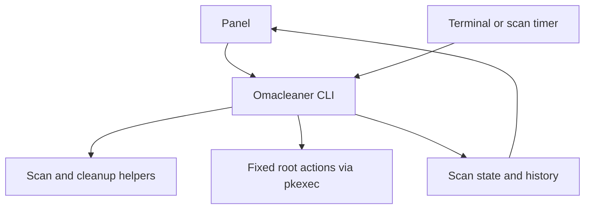

# Architecture

| File | Role |
| --- | --- |
| manifest.json | Omarchy bar widget identity and settings |
| Panel.qml / DetailText.qml | Bar button, popup and plain-text detail rendering |
| bin/omacleaner | CLI and shared backend |
| bin/omacleaner-root | Privileged helper with fixed verbs |
| lib/common.sh | Paths, configuration, ignore rules and deletion guards |
| lib/modules.sh | Cleanup registry and scan functions |
| lib/details.json | Category scope/effects and recognized cache-name guidance |
| lib/memory.sh | Memory reporting and process actions |
| tests/run.sh | Tests using temporary home folders |
| install.sh | Local source installer |

## Data flow



- The panel never decides what to delete. It passes module ids to `clean`, and
  the CLI re-scans and applies its own guards.
- State lives in one file that is replaced atomically. The panel watches it,
  so the bar stays in sync with whatever ran the CLI.

## Module contract

A module is one registry line in `OC_MODULES` (`lib/modules.sh`):

```
id|title|description|kind|default|risk|mode
```

plus functions named after the id (dashes become underscores):

| Function | Required | Purpose |
|---|---|---|
| `oc_scan_<id>` | yes | print items as `bytes<TAB>path<TAB>label`; must not modify anything |
| `oc_avail_<id>` | no | print a reason and return 1 when the module cannot run |
| `oc_verbs_<id>` | root modules | print the helper verb(s), e.g. `journal 200` |
| `oc_clean_<id>` | command modules | perform the cleanup as the user |

User modules are cleaned generically according to `mode`:

| mode | Action per item |
|---|---|
| `contents` | `oc_empty_dir`: remove the entries inside, keep the directory |
| `delete` | `oc_delete`: remove the item |
| `trash` | `oc_trash`: move the item to the freedesktop Trash |
| `report` | never cleaned in bulk; individual removal through `omacleaner trash` |

All three removal helpers call `oc_path_allowed` on the item itself. Before
anything recursive happens, they also check `oc_has_ignored_descendant`:

- `oc_empty_dir` and `oc_delete` walk the tree with `oc_prune_tree`. It
  removes whole entries that hold no excluded path and descends into those
  that do.
- `oc_trash` refuses a folder that holds an excluded path.

`oc_reclaimable_bytes` subtracts the protected parts from scan sizes.

`oc_path_allowed` itself accepts only absolute paths inside `$HOME` (or a mounted drive's `.Trash-UID`), and it rejects `..`,
`$HOME` itself, the top-level XDG directories, the plugin's own config, and
anything on the ignore list. `rm` always runs with `--one-file-system`.

### Adding a module

1. Add a registry line. Choose `default=0` unless the data is a pure cache.
2. Write `oc_scan_<id>` using `oc_emit_path` (path items) or `oc_emit`
   (pseudo items).
3. For root work, add a verb to `bin/omacleaner-root`. Validate the whole
   argument list before anything runs, and never accept a path. Then add
   `oc_verbs_<id>`.
4. Add scope, effect, keeps and advice entries to `lib/details.json`. Cache names can also match a userCaches rule; unmatched names get cautious generic guidance.
5. Add a test in `tests/run.sh`, then document the module in `README.md` and
   `CHANGELOG.md`.

## Memory view

`oc_process_table` reads `smaps_rollup`, `cgroup`, `comm` and `stat` for every
PID in a single gawk pass. `BEGINFILE` skips files it cannot read, which are
the processes of other users. The jq stage groups processes by cgroup leaf
(the systemd unit) and derives a display name:

- the unit name for `app-*.scope` and `app-*.service` units, decoded;
- otherwise, or when the unit is named after a launcher such as `gtk-launch`
  or `xdg-terminal-exec`, the comm of the group's first process.

Quitting goes through `systemctl --user kill`, so every process of the app gets
the signal, children included. The unit is re-checked against a fresh listing
right before the signal is sent.

## Privileged helper

`bin/omacleaner-root` refuses to run unless it is root. It validates the
complete argument list against a closed set of verbs, and numeric arguments
must be at most 6 digits. It sets a fixed `PATH` and prints one JSON line per
verb. The CLI batches every root verb of a clean into a single `pkexec` call,
so you authenticate once.
